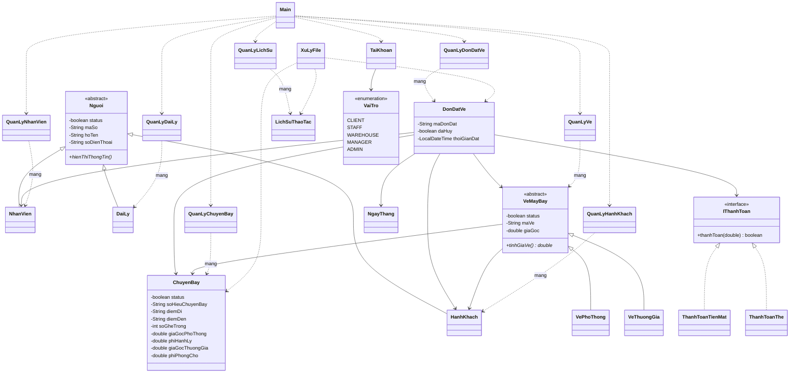

# Quan ly ban ve may bay

Ung dung Java chay tren terminal, dung mang doi tuong de quan ly chuyen bay, hanh khach, nhan vien, dai ly, ve va don dat ve.

## Chay chuong trinh

Mo terminal tai thu muc nay va chay:

```powershell
javac -encoding UTF-8 -d out *.java
java -cp out Main
```

Ma `.class` duoc tao trong thu muc `out`, khong nam canh cac file `.java`. Tai khoan minh hoa: `client`, `staff`, `warehouse`, `manager`, `admin`; mat khau: `123456`.

## So do lop



## Doi chieu yeu cau do an

- Co hon 15 lop, cac lop du lieu co constructor va co lop truu tuong `Nguoi`, `VeMayBay`.
- Ke thua the hien qua `Nguoi` va `VeMayBay`; da hinh the hien qua `hienThiThongTin()` va cac lop ve; thanh toan dung interface `IThanhToan`.
- Cac danh sach nghiep vu dung mang, khong dung `ArrayList`, `Vector` hay `LinkedList`.
- `XuLyFile` doc/ghi du lieu UTF-8 vao cac tep `.txt` trong `data`. Moi dong du lieu doi tuong hien duoc ma hoa Base64 de luu va nap lai.
- Thuc the co trang thai de ngung/khoi phuc ma van giu lich su; don dat ve duoc huy mem, khong xoa khoi tep.
- Menu phan quyen theo vai tro; co nhat ky thao tac, tim kiem gan dung, nhap nhieu ban ghi, gia ve theo hang va bao cao thang/quy/nam.
- Bao cao gom doanh thu theo nhan vien, chuyen bay ban chay/it khach va thang ban chay/it khach.

Luu y: du lieu `.txt` la van ban UTF-8 nhung phan noi dung doi tuong duoc ma hoa Base64; mo tep truc tiep se khong doc duoc cac truong nhu ten, ma va gia.
